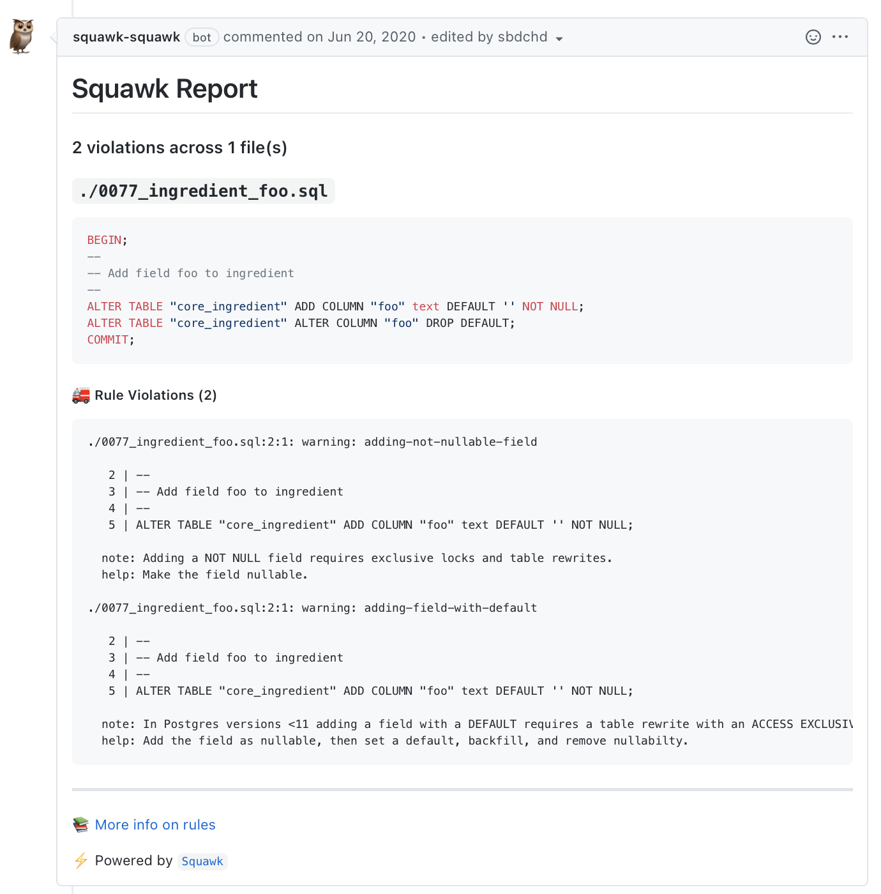

# squawk-action 

A GitHub Action for [Squawk](https://github.com/sbdchd/squawk).

Lint Postgres migrations and report violations as a comment in a GitHub Pull Request ([example PR](https://github.com/sbdchd/squawk/pull/14#issuecomment-647009446)).

For more information on Squawk, see the [Squawk GitHub repository](https://github.com/sbdchd/squawk) or [website](https://squawkhq.com).

## basic usage

Lint every .sql file in `migrations/` on every pull request.

```yml
# .github/workflows/lint-migrations.yml
name: Lint Migrations

on: pull_request

jobs:
  lint_migrations:
    runs-on: ubuntu-latest
    steps:
      - uses: actions/checkout@v6
      - uses: sbdchd/squawk-action@v2
        with:
          pattern: "migrations/*.sql"
          version: "latest"
```

## advanced usage

Only lint modified .sql files in the `migrations/`.

```yml
# .github/workflows/lint-migrations.yml
name: Lint Migrations

on: pull_request

jobs:
  lint_migrations:
    runs-on: ubuntu-latest
    steps:
      - uses: actions/checkout@v6
        with:
          fetch-depth: 0
      - name: Find modified migrations
        run: |
          modified_migrations=$(git diff --diff-filter=d --name-only origin/$GITHUB_BASE_REF...origin/$GITHUB_HEAD_REF 'migrations/*.sql' | tr '\n' ' ')
          echo "$modified_migrations"
          echo "file_names=$modified_migrations" >> $GITHUB_OUTPUT
        id: modified-migrations
      - uses: sbdchd/squawk-action@v2
        with:
          files: ${{ steps.modified-migrations.outputs.file_names }}
```

> [!TIP]
> See `action.yml` for more action inputs.

## reviewdog

Set `reporter: reviewdog` to report violations through [reviewdog](https://github.com/reviewdog/reviewdog) instead of a single PR comment. With the default `github-pr-review` reporter, each violation becomes an inline review comment on the offending line.

```yml
# .github/workflows/lint-migrations.yml
name: Lint Migrations

on: pull_request

jobs:
  lint_migrations:
    runs-on: ubuntu-latest
    permissions:
      contents: read
      pull-requests: write # github-pr-review
      checks: write # github-pr-check, github-check
    steps:
      - uses: actions/checkout@v6
      - uses: sbdchd/squawk-action@v2
        with:
          pattern: "migrations/*.sql"
          reporter: reviewdog
          reviewdog-reporter: github-pr-review
          reviewdog-filter-mode: added
```

`reviewdog-reporter` and `reviewdog-filter-mode` take reviewdog's [reporters](https://github.com/reviewdog/reviewdog#reporters) and [filter modes](https://github.com/reviewdog/reviewdog#filter-mode). `upload-to-github` is ignored, and `fail-on-violations: true` fails the step when reviewdog reports any violation (`-fail-level=any`).

## example report

[](https://github.com/sbdchd/squawk/pull/14#issuecomment-647009446)

## development

### releasing a new version

1. [Release a new version](https://github.com/sbdchd/squawk-action/releases) (e.g. v5.2.1)
2. Update major version tag to point to commit.
   ```bash
   git tag v5
   git push --tags
   ```
